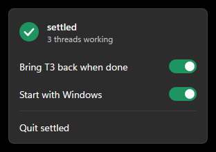

# settled

I give an AI agent a task in [T3 Code](https://github.com/pingdotgg/t3code), then go back to studying. A minute later I look at the monitor to check if it is done. Then again. I do this all day, and it breaks every bit of focus I had.

settled ends the checking. Start a task, minimize T3 Code, and look away. When the agent is done, settled brings T3 Code back to the screen, opened on the thread that finished. If T3 Code is already on screen, settled does nothing.



## Install

Windows 10 or 11 with the T3 Code desktop app. Build it with [Rust](https://rustup.rs):

```
cargo build --release
```

Run `target\release\settled.exe`. A green check appears in the tray; drag it out of the overflow menu if you want to see it. On first launch settled adds itself to Windows startup.

Click the tray icon for the panel:

- **Bring T3 back when done** pauses settled when off. The icon turns grey.
- **Start with Windows** adds or removes the startup entry.
- **Quit settled** stops it.

## When a task counts as done

A thread you started counts as done when its run ends and nothing it waits on is still running: no subagent, no delegated task, no background command the agent said it waits for. A question the agent asks you counts too, because it needs you. Subagent and delegated threads are ignored; their parent reports for them.

settled waits 2 seconds before it acts. If the thread starts again in that time, for example because you queued a follow-up message, it keeps waiting.

## How it works

- At start, settled runs `t3 auth session issue --scope orchestration:read` to get a read-only token. It can see threads but cannot change anything. The token expires after a day and settled asks for a new one.
- It opens one WebSocket to the local T3 server and subscribes to the same live thread list the T3 sidebar uses. It does not poll. It wakes only when T3 sends a change. With three agents running it used 16 ms of CPU time in 30 seconds.
- When a thread is done and every T3 Code window is minimized, it opens `t3code://threads/<environment>/<thread>`, which T3 Code handles by restoring its window on that thread.

The exe is about 600 KB. It uses about 13 MB of memory, 3 MB of it its own.

## Limits

- Windows may restore T3 Code without giving it keyboard focus.
- It reads T3 Code's internal thread stream, which can change between T3 releases. If settled stops reacting after a T3 update, the stream changed.
- settled watches only the T3 Code server on this computer, not remote environments.

## License

MIT
